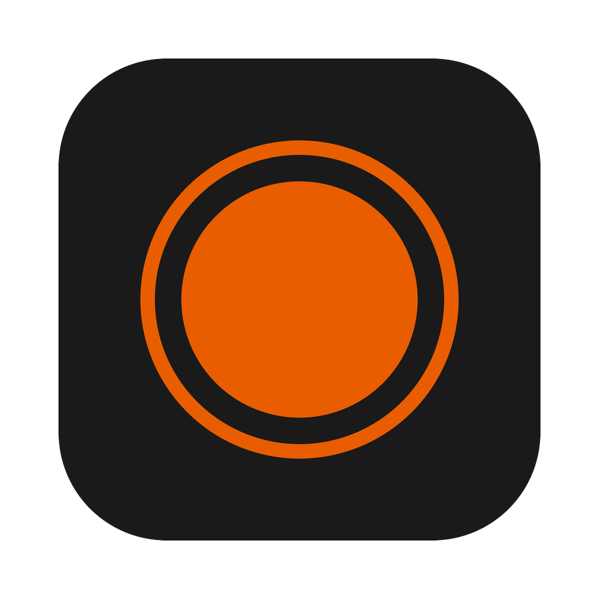
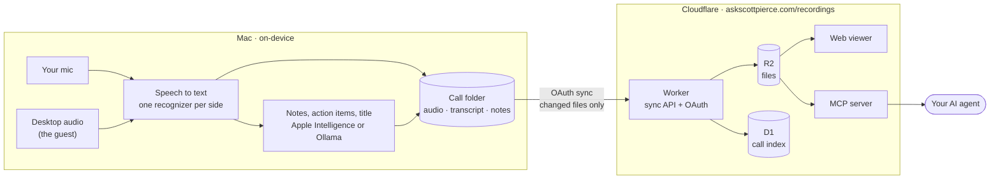

# Recorder

I get invited to meetings on more platforms than I can count, and most of them only record if the host pays for it. The usual workaround is a separate recorder sitting next to the laptop, picking up the speakers and you over the air. That means no headset, so it's useless in a noisy office or a coffee shop.

Recorder is a Mac app that records the call from your headset, transcribes both sides, and puts the transcripts somewhere you and your AI agent can both get to them.

## What it does

- **Records any call, on any platform.** Your mic is one track, and everything the Mac plays is the other. No bot joins the meeting, and the host's plan doesn't matter.
- **Works with a headset.** Bluetooth included, so you can take the call anywhere. Without one, the guest's voice coming back through your mic is filtered out of the transcript.
- **Knows who said what.** Each side has its own track and its own recognizer, so speaker labels come from the hardware, not from a model guessing voices.
- **Transcribes on your Mac, live.** Apple's on-device speech recognition shows the call as a chat while it happens.
- **Writes the notes.** Apple Intelligence (or Ollama) writes a summary, decisions, action items, open questions, and a title.
- **Syncs to Cloudflare.** Calls land in a small Worker at [askscottpierce.com/recordings](https://askscottpierce.com/recordings), where you can read them and play them back from any browser. It's standard OAuth, so you can point the app at your own server.
- **Hands them to your AI agent.** The same Worker is an MCP server, so Claude or any MCP client can list, search, and read your calls.



Audio never leaves the Mac to be transcribed. Sync is the only part that touches the network, and it's off until you connect it.

## Connect your AI agent

Add the MCP server, then sign in once in your browser when it asks:

```sh
claude mcp add --transport http recordings https://askscottpierce.com/recordings/mcp
```

Any client that speaks MCP over HTTP with OAuth works. In Claude.ai, add it as a custom connector with the same URL. Agents get read-only access through three tools: `list_calls`, `search_calls`, and `get_call` (notes, transcript, or both).

## Install

You'll need macOS 26 on Apple silicon, Apple Intelligence turned on (or Ollama), and a headset.

```sh
make release   # build, sign, notarize, and install to /Applications
make run       # or just build and open it
```

The first recording asks for **Microphone** and **System Audio Recording Only** permission. Press **⌘R** to start and stop. Settings → Sync connects it to a server.

Calls are saved to `~/Documents/Recorder/`, one folder per call: `me.m4a`, `them.m4a`, `transcript.md`, `notes.md`, and `meeting.json`. Trashing a call, in the app or on the web, trashes it in both places, and you can restore it from either for 30 days.

## More

- [docs/DEVELOPING.md](docs/DEVELOPING.md): building, the command line, a code map, and the gotchas we hit.
- [web/README.md](web/README.md): the Cloudflare Worker, the sync API, the MCP server, and hosting your own.
